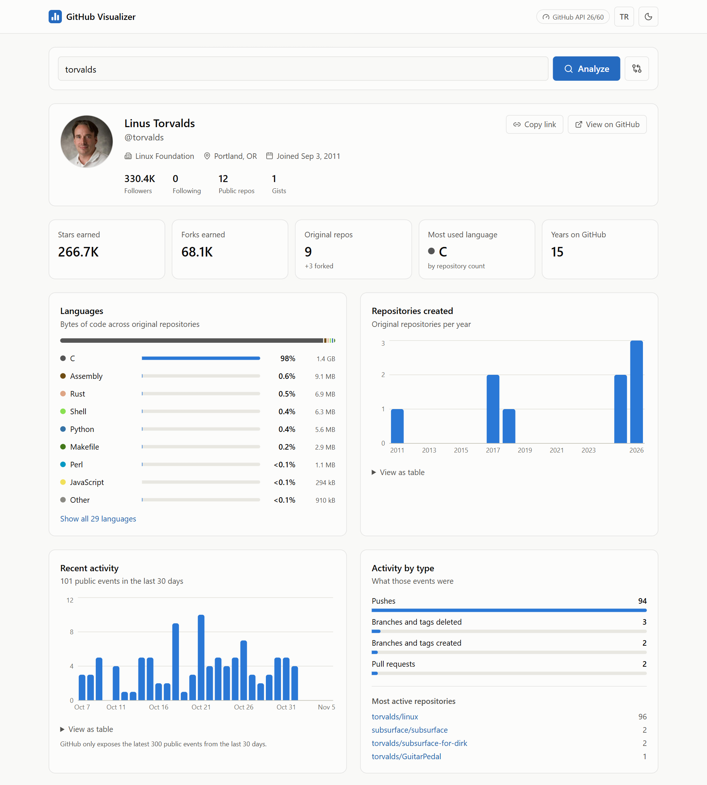
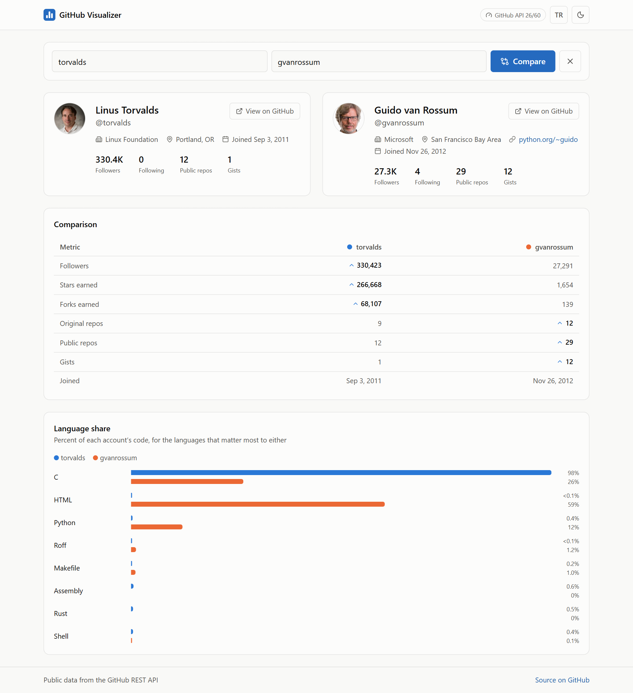
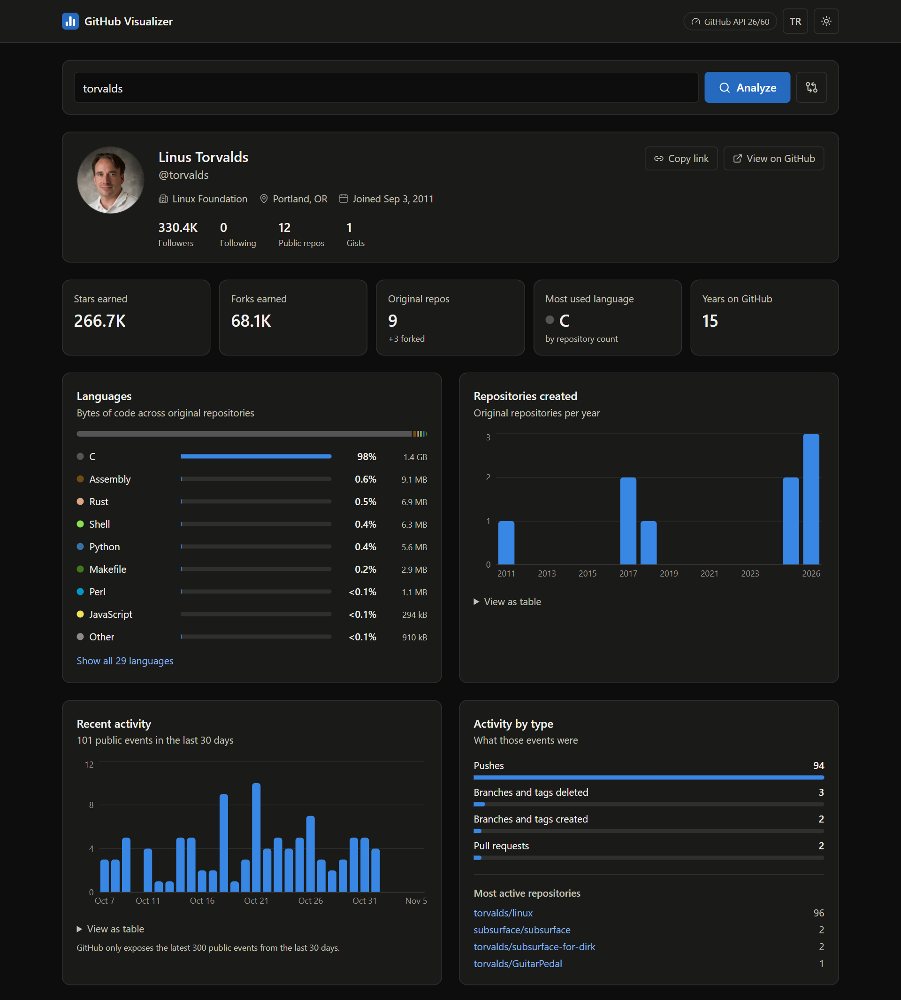
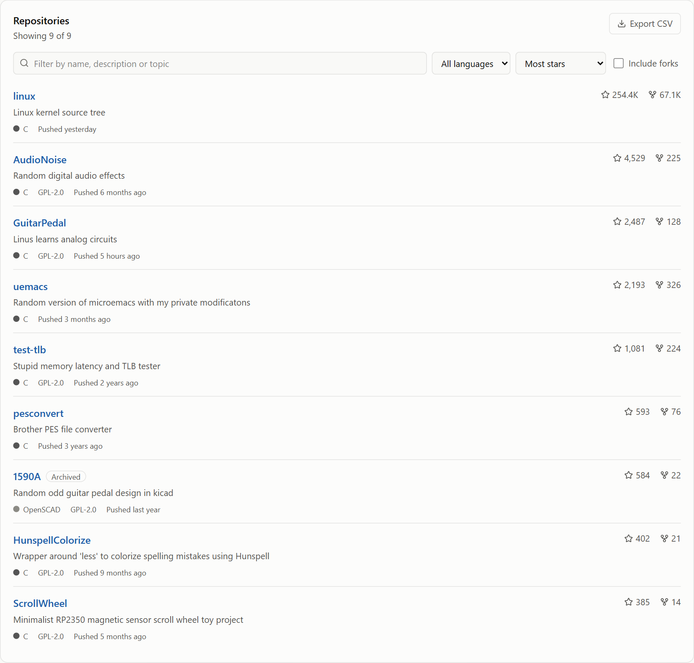
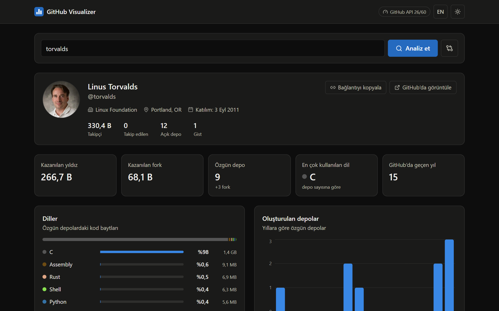
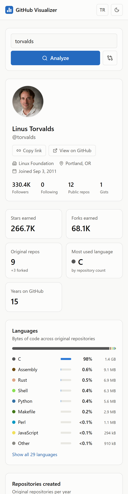
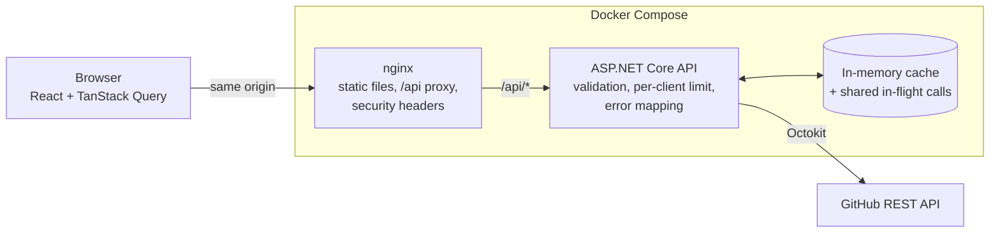

<div align="center">

# GitHub Visualizer

**Turn any public GitHub profile into an interactive dashboard: languages, repositories, recent activity and side-by-side comparisons.**

### [Try the live demo](https://erayildirim-github-visualizer.onrender.com/?user=torvalds)

<sub>Hosted on a free plan: the first search after a quiet period can take up to a minute while the API wakes up.</sub>

[](https://github.com/erayildirim/GithubVisualizer/actions/workflows/ci.yml)


[](LICENSE)



</div>

## Features

- **Rich profile view:** avatar, bio, company, location, website, followers and join date.
- **Accurate language breakdown:** measured in bytes of code across original repositories, using the same colors as GitHub.
- **Repository explorer:** search by name, description or topic; filter by language; sort by stars, forks, last push, age or name; include or hide forks; export to CSV.
- **Activity charts:** public events from the last 30 days, by day and by type, plus the most active repositories.
- **Creation timeline:** original repositories created per year.
- **User comparison:** two accounts side by side, with the leader marked for every metric and a shared language chart.
- **Shareable links:** every view lives in the URL (`?user=torvalds&vs=gvanrossum`), and the back button works.
- **Light and dark themes**, following your system setting until you choose one.
- **English and Turkish interface**, with numbers and dates formatted for the selected language.
- **Responsive and accessible:** works down to phone width, supports keyboard navigation, and every chart has a table view.

### Built to respect GitHub's rate limit

GitHub allows only 60 unauthenticated requests per hour, and an accurate language breakdown needs one request per repository. The backend is designed around that limit:

- Responses are **cached**, and simultaneous requests share a single GitHub call.
- Forks, empty repositories and repositories with no detected language are **skipped**, saving a request each.
- The **largest repositories are analyzed first**, so a limited budget covers the most code.
- When the quota runs short, you get a **partial result that says so** ("Based on 30 of 120 repositories") instead of silently wrong numbers.
- A **live quota badge** in the header shows what's left, and errors tell you when the limit resets.

## Screenshots

| Compare two accounts | Dark theme |
| :---: | :---: |
|  |  |

| Repository explorer | Turkish interface | Mobile |
| :---: | :---: | :---: |
|  |  |  |

## Quick start

### With Docker (recommended)

You only need [Docker](https://www.docker.com/products/docker-desktop/).

```bash
git clone https://github.com/erayildirim/GithubVisualizer.git
cd GithubVisualizer
docker compose up --build
```

Open **http://localhost:5173**.

### Without Docker

You need the [.NET 10 SDK](https://dotnet.microsoft.com/download/dotnet/10.0) and [Node.js 22](https://nodejs.org/). Run each command in its own terminal, from the repository root:

```bash
# Terminal 1: API on http://localhost:5225 (Swagger UI at /swagger)
dotnet run --project backend
```

```bash
# Terminal 2: app on http://localhost:5173
cd frontend
npm install
npm run dev
```

### Add a GitHub token (optional, recommended)

A token raises the limit from **60 to 5,000 requests per hour**, enough for full language coverage on large accounts. Create a [personal access token](https://github.com/settings/personal-access-tokens); it needs no extra permissions because the app only reads public data.

```bash
# Docker: create a .env file, then set GITHUB_TOKEN in it
cp .env.example .env

# Without Docker: store it outside the repository using .NET user secrets
dotnet user-secrets set "GitHub:Token" "<your-token>" --project backend
```

The token stays on the server and is never sent to the browser.

## Usage

1. **Search:** enter a username, an `@handle` or a pasted profile URL, then press **Analyze**.
2. **Explore:** hover over charts for exact values, or open **View as table** below a chart.
3. **Filter repositories:** combine the search box, language and sort menus, and the **Include forks** box. **Export CSV** downloads exactly what's listed.
4. **Compare:** press the compare button next to **Analyze**, enter a second username, then press **Compare**.
5. **Share:** copy the address from your browser, or use **Copy link** on a profile.
6. **Personalize:** use the header buttons to switch language and theme. Both choices are remembered.

## Architecture



The browser only ever talks to its own origin, which keeps the token on the server and means no CORS is needed in production. In development, the Vite dev server plays nginx's role by proxying `/api` to the backend.

### Tech stack

| Layer | Technology | Used for |
| --- | --- | --- |
| Backend | ASP.NET Core 10 (C#) | REST API, middleware and dependency injection |
| | Octokit | Typed GitHub API client |
| | IMemoryCache | Reusing responses to save GitHub quota |
| | Built-in rate limiter | Protecting a deployed server's quota from abuse |
| | Swashbuckle | Interactive API docs in development |
| Frontend | React 19 and TypeScript | Type-safe UI components |
| | Vite | Dev server and production bundling |
| | TanStack Query | Fetching, caching and retrying, with requests canceled when no longer needed |
| | Axios | HTTP client |
| | Tailwind CSS 4 | Styling and theming through CSS variables |
| | Recharts | Column charts, loaded on demand to keep the first page light |
| | Lucide | Icons |
| Testing | xUnit, NSubstitute, WebApplicationFactory | Backend unit and API integration tests |
| | Vitest, Testing Library | Frontend logic and user-flow tests |
| Delivery | Docker, nginx, Docker Compose | Non-root production containers |
| | GitHub Actions | Lint, test and build on every push |

## API

The base path is `/api/github`. All endpoints are read-only `GET` requests.

| Endpoint | Returns |
| --- | --- |
| `/user/{username}` | Public profile |
| `/user/{username}/repos` | Public repositories, including forks (up to 500) |
| `/user/{username}/languages` | Bytes and percentage per language, with coverage information |
| `/user/{username}/activity` | Public events from the last 30 days, by day, type and repository |
| `/rate-limit` | Remaining GitHub quota (free to call) |

The backend also exposes `GET /health` for service monitoring.

<details>
<summary>Example: language breakdown</summary>

```bash
curl http://localhost:5173/api/github/user/octocat/languages
```

```json
{
  "languages": {
    "CSS": { "bytes": 14950, "percentage": 77.32 },
    "HTML": { "bytes": 4338, "percentage": 22.43 },
    "JavaScript": { "bytes": 48, "percentage": 0.25 }
  },
  "totalBytes": 19336,
  "repositoriesAnalyzed": 2,
  "repositoriesEligible": 2,
  "isPartial": false
}
```

</details>

Errors follow the [RFC 9457 problem details](https://www.rfc-editor.org/rfc/rfc9457) format, with a stable `code` field:

| Status | Code | Meaning |
| --- | --- | --- |
| 400 | *(validation errors)* | Not a valid GitHub username |
| 404 | `not_found` | The account doesn't exist |
| 429 | `rate_limited` | GitHub quota exhausted; includes `resetsAt` and a `Retry-After` header |
| 429 | `too_many_requests` | This client exceeded the server's own limit |
| 502 | `invalid_token` | GitHub rejected the configured token |
| 502 | `upstream_error` | GitHub returned an unexpected response |
| 503 | `upstream_unreachable` | GitHub couldn't be reached |
| 504 | `upstream_timeout` | GitHub took too long to respond |

## Configuration

Backend settings live in [`backend/appsettings.json`](backend/appsettings.json). Any of them can be overridden with an environment variable, using a double underscore for nesting (for example `GitHub__CacheMinutes=30`).

| Setting | Default | Purpose |
| --- | --- | --- |
| `GitHub:Token` | *none* | GitHub personal access token |
| `GitHub:CacheMinutes` | `10` | How long responses are reused |
| `GitHub:PartialResultCacheMinutes` | `2` | How long incomplete language results are reused |
| `GitHub:MaxLanguageRepositories` | `100` | Most repositories analyzed per language breakdown |
| `GitHub:ReservedRequests` | `5` | Quota that language analysis leaves for other requests |
| `GitHub:MaxParallelRequests` | `5` | Simultaneous language requests |
| `GitHub:MaxRepositoryPages` | `5` | Repository pages fetched (100 per page) |
| `GitHub:RequestTimeoutSeconds` | `15` | Timeout for each GitHub request |
| `Cors:AllowedOrigins` | `http://localhost:5173` | Origins allowed if the frontend is hosted separately |
| `RateLimiting:PermitsPerMinute` | `120` | Requests allowed per client per minute |
| `ReverseProxy:Enabled` | `false` | Trust forwarded client addresses (only behind a trusted proxy) |

| Frontend or Compose variable | Default | Purpose |
| --- | --- | --- |
| `GITHUB_TOKEN` | *none* | Token passed to the backend by Compose |
| `FRONTEND_PORT` | `5173` | Port the Docker setup is served on |
| `VITE_API_BASE_URL` | `/api` | API location, set at build time, if hosted elsewhere |
| `VITE_PROXY_TARGET` | `http://localhost:5225` | Backend address for the dev server's proxy |

## Development

```bash
# Backend tests, from the repository root
dotnet test

# Frontend checks, from frontend/
npm run lint
npm test
npm run build
```

GitHub Actions runs all of these, plus a Docker image build, on every push and pull request. Tests use fakes, so they need neither network access nor GitHub quota.

### Project structure

```text
GithubVisualizer/
├── backend/                     ASP.NET Core API
│   ├── Controllers/             HTTP endpoints and input validation
│   ├── Services/                GitHub access, language analysis and caching
│   ├── Models/                  Response types
│   ├── Options/                 Typed configuration
│   ├── Infrastructure/          Maps failures to problem responses
│   └── Program.cs               Service and middleware setup
├── frontend/                    React app
│   ├── src/components/          Dashboard panels, charts and compare view
│   ├── src/hooks/               Data fetching, URL state, theme and recent searches
│   ├── src/i18n/                English and Turkish translations
│   ├── src/lib/                 Statistics, formatting and URL safety (unit tested)
│   ├── src/services/api.ts      Typed API client
│   └── nginx.conf               Production web server and API proxy
├── tests/backend.Tests/         Backend unit and integration tests
├── docs/screenshots/            Images used in this README
├── .github/workflows/ci.yml     Continuous integration
└── docker-compose.yml           Runs the whole stack
```

## Deploy your own

[`render.yaml`](render.yaml) deploys the app to [Render](https://render.com)'s free plan: the React app as a static site, and the API as a Docker web service.

1. Fork this repository and change the service names in `render.yaml`. Render addresses are unique, and the `/api/*` rewrite must point at your API's address.
2. In the Render dashboard, choose **New > Blueprint** and select your fork.
3. When asked for `GitHub__Token`, paste a [personal access token](https://github.com/settings/personal-access-tokens). A shared host's address may already have used up GitHub's anonymous limit.

The free API sleeps after 15 idle minutes, so the first search after a quiet period takes about a minute.

## Limitations

These come from what GitHub's API exposes:

- **Public data only.** Private repositories and private contributions never appear.
- **Activity isn't the contribution graph.** GitHub's events feed covers at most the latest 300 public events from the last 30 days, so totals can be lower than the green squares on a profile.
- **Language sizes count bytes, not lines,** and include any code checked into a repository, such as vendored libraries.
- **Very large accounts are capped** at 500 repositories per lookup to protect the quota. The app shows a notice when this applies.

## License

Released under the [MIT License](LICENSE).
